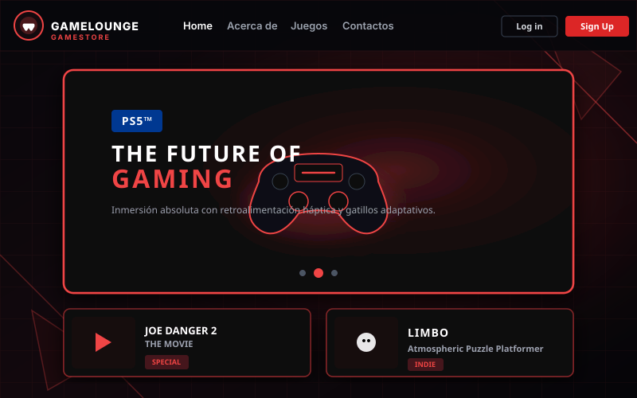

# Braian Nahuel Dorrego

**Desarrollador Full Stack · .NET + Angular**  
**Full Stack Developer · .NET + Angular**

Berazategui, Buenos Aires, Argentina

[Español](#español) · [English](#english) · [Stack](#stack) · [Contacto](#contacto)

---

## Stack

### Frontend

  

### Backend

  

### Bases de datos / Databases

  

### Herramientas / Tools

  

---

## Enfoque técnico / Technical approach

- **Arquitectura / Architecture:** capas, hexagonal, Repository, DTOs, SOLID.
- **Datos / Data:** Entity Framework Core, SQL Server, PostgreSQL.
- **Calidad / Quality:** xUnit, Moq, code reviews, Clean Code.
- **Entrega / Delivery:** Git/GitHub, Docker, GitHub Actions, Scrum.

---

## Español

### Perfil

Desarrollador Full Stack con foco en **.NET** y **Angular**. Con más de cinco años construyendo experiencia entre formación, proyectos personales y trabajo profesional, trabajé en consultoría IT desarrollando soluciones para la gestión logística y administrativa de **Correo Argentino**, con APIs REST, procesos críticos y arquitecturas mantenibles.

Me interesa construir aplicaciones claras de punta a punta: APIs bien diseñadas, modelos de datos sólidos y una experiencia de usuario simple. Disfruto entender el problema antes de escribir código, aplicar buenas prácticas y seguir aprendiendo.

Actualmente curso **Ingeniería en Informática** en la **Universidad Nacional Arturo Jauretche (UNAJ)**, con más del 70% de la carrera aprobado.

| Dato | Detalle |
| --- | --- |
| **Rol** | Full Stack Developer |
| **Foco** | .NET + Angular |
| **Ubicación** | Berazategui, Buenos Aires, Argentina |
| **Teléfono** | [+54 11 7360-0290](tel:+541173600290) |
| **Formación** | Ingeniería en Informática · UNAJ (+70%) |
| **Idiomas** | Español nativo · Inglés A1 en formación |
| **CV** | [Descargar PDF](./CV-Braian-Dorrego.pdf) |
| **Disponibilidad** | Abierto a nuevas oportunidades Full Stack |

### Experiencia

#### Desarrollador Full Stack

**Consultora IT · Proyecto para Correo Argentino**  
`05/2024 — 09/2026` · Proyecto finalizado en septiembre de 2026

- Desarrollo de endpoints RESTful en **.NET Core** para cálculo de costos de envío, notificaciones y packing.
- Implementación de un módulo de carga masiva de SKUs y órdenes desde CSV, reduciendo el tiempo de ingreso aproximadamente un **80%**.
- Trabajo con arquitectura limpia y hexagonal, pruebas unitarias, revisiones de código y ceremonias **Scrum**.
- Participación en el diseño de soluciones para procesos logísticos y administrativos críticos.

#### Beca de investigación

**Universidad Nacional Arturo Jauretche (UNAJ)**  
`2021`

- Participación en una beca para simular la obtención de alimentos en colonias de hormigas.
- Aplicación de **Computación de Altas Prestaciones (HPC)**.
- Trabajo presentado en el **9º Congreso Nacional de Ingeniería Informática/Sistemas de Información (CoNaIISI 2021)**.

### Proyectos destacados

#### 01 · Reset Programs

**Automatización para Windows · 2026**

Aplicación de escritorio para preparar un Windows recién instalado e instalar los programas habituales con **WinGet**. La interfaz permite seleccionar programas por categoría, detectar cuáles ya están instalados, seguir el progreso en tiempo real y revisar un resumen con logs.

No incluye instaladores: descarga los paquetes desde las fuentes configuradas en Windows. La lista de programas se define en un archivo JSON, sin necesidad de modificar la interfaz.

**Stack:** PowerShell · Windows Forms · WinGet · JSON  
**Repositorio:** [winget-bundle-ninite](https://github.com/DorregoBraian/winget-bundle-ninite)

---

#### 02 · RopaStore — E-commerce con Angular

**Frontend · 2024**

Tienda de ropa online desarrollada para practicar Angular y Firebase. Incluye catálogo, filtros por categoría, selector de moneda, detalle de producto, carrito, favoritos, registro e inicio de sesión, foto de perfil y modo oscuro.

Los datos de usuario se guardan en **Firestore**, las imágenes en **Firebase Storage** y el carrito y los favoritos en `localStorage` por usuario.

**Stack:** Angular 18.1 · TypeScript · Firebase Auth/Firestore/Storage · Bootstrap 5 · Fake Store API  
**Demo:** [RopaStore](https://dorregobraian.github.io/Proyecto-Ecommerce-con-Angular-17/) · **Repositorio:** [Proyecto-Ecommerce-con-Angular-17](https://github.com/DorregoBraian/Proyecto-Ecommerce-con-Angular-17)

 

---

#### 03 · Plataforma de venta de videojuegos

**Full Stack · 2024**

E-commerce de videojuegos estilo Steam, con frontend en **Angular** y backend compuesto por microservicios en **C#/.NET Core**. Incluye autenticación, carrito, favoritos, filtros, envío de correos SMTP, tareas en segundo plano y pruebas unitarias.

El backend está separado en una API REST principal, un servicio de testing y una tarea en segundo plano que carga videojuegos desde un archivo JSON.

**Stack:** Angular · C# · .NET Core · APIs REST · xUnit · Moq · Arquitectura hexagonal  
**Demo:** [Plataforma de videojuegos](https://dorregobraian.github.io/Proyecto-Venta-Videojuegos) · **Repositorio:** [Proyecto-Venta-Videojuegos](https://github.com/DorregoBraian/Proyecto-Venta-Videojuegos)

 

---

#### 04 · PokeCardStore

**Frontend · 2023**

Tienda/demo de cartas Pokémon que consume **PokeAPI**. El catálogo permite filtrar por región, tipo y color, ver el detalle de cada carta, guardar favoritos en `localStorage` y contactar al vendedor mediante un formulario.

También incluye una implementación alternativa en **Vue 3** para comparar enfoques de desarrollo.

**Stack:** HTML · CSS · JavaScript · jQuery · Bootstrap 5 · PokeAPI  
**Demo:** [PokeCardStore](https://dorregobraian.github.io/PokeCardStore/) · **Repositorio:** [PokeCardStore](https://github.com/DorregoBraian/PokeCardStore)

 

---

#### 05 · Gestión de Biblioteca Municipal

**Full Stack · Proyecto académico · 2026**

Sistema para administrar libros, clientes, reservas y alquileres de una biblioteca municipal. Permite consultar disponibilidad, registrar clientes, gestionar reservas y alquileres, calcular fechas de devolución y controlar el stock.

La solución está separada en un frontend estático y una API REST en **.NET 6** con arquitectura en capas, Repository, DTOs, AutoMapper, Swagger y **Entity Framework Core + SQL Server**.

**Stack:** .NET 6 · C# · ASP.NET Core · EF Core · SQL Server · Swagger · JavaScript  
**Repositorio:** [LibreriaMunicipal](https://github.com/DorregoBraian/LibreriaMunicipal)

 

---

#### 06 · Simulación de colonias de hormigas

**Investigación · UNAJ · 2021**

Participación en una beca de investigación para simular la obtención de alimentos en colonias de hormigas mediante técnicas de **Computación de Altas Prestaciones (HPC)**. El trabajo fue presentado en **CoNaIISI 2021**.

**Stack:** HPC · Simulación · Investigación académica

[Ver todos mis repositorios](https://github.com/DorregoBraian?tab=repositories)

### Formación

| Año | Formación | Institución |
| --- | --- | --- |
| 2018 — Actualidad | Ingeniería en Informática · +70% aprobado | Universidad Nacional Arturo Jauretche (UNAJ) |
| 2023 | Python Full Stack | Codo a Codo GCBA |
| 2022 | Formación y Certificación en Lenguas Extranjeras | Beca Manuel Belgrano |
| 2019 | Seguridad de Redes e Informática y Hacking | Universidad Nacional Arturo Jauretche (UNAJ) |

#### Certificaciones y cursos

- **Python Full Stack** — Codo a Codo GCBA, 2023.
- **Seguridad de Redes e Informática y Hacking** — UNAJ, 2019.
- **Formación y Certificación en Lenguas Extranjeras** — Beca Manuel Belgrano, 2022.

### Cómo trabajo

- Comunicación clara y trabajo en equipo.
- Adaptabilidad y aprendizaje continuo.
- Resolución de problemas con foco en soluciones mantenibles.
- Recepción de feedback y mejora constante.
- Organización, responsabilidad y atención al detalle.

---

## English

### Profile

Full Stack Developer focused on **.NET** and **Angular**. With more than five years of experience across education, personal projects, and professional work, I worked at an IT consulting firm building solutions for **Correo Argentino**'s logistics and administrative operations, using REST APIs, critical processes, and maintainable architectures.

I enjoy building applications end to end: well-designed APIs, solid data models, and a simple user experience. I like understanding the problem before writing code, applying good practices, and continuously learning.

I am currently studying **Computer Engineering** at **Universidad Nacional Arturo Jauretche (UNAJ)**, with more than 70% of the degree completed.

| Item | Detail |
| --- | --- |
| **Role** | Full Stack Developer |
| **Focus** | .NET + Angular |
| **Location** | Berazategui, Buenos Aires, Argentina |
| **Phone** | [+54 11 7360-0290](tel:+541173600290) |
| **Education** | Computer Engineering · UNAJ (70%+) |
| **Languages** | Spanish (native) · English A1 (in progress) |
| **CV** | [Download PDF](./CV-Braian-Dorrego.pdf) |
| **Availability** | Open to new Full Stack opportunities |

### Experience

#### Full Stack Developer

**IT Consulting Firm · Project for Correo Argentino**  
`05/2024 — 09/2026` · Project completed in September 2026

- Developed RESTful endpoints in **.NET Core** for shipping cost calculation, notifications, and packing.
- Built a bulk upload module for SKUs and orders from CSV files, reducing data entry time by approximately **80%**.
- Worked with clean and hexagonal architecture, unit tests, code reviews, and **Scrum** ceremonies.
- Contributed to solution design for critical logistics and administrative processes.

#### Research Scholarship

**Universidad Nacional Arturo Jauretche (UNAJ)**  
`2021`

- Participated in a research scholarship to simulate food gathering in ant colonies.
- Applied **High-Performance Computing (HPC)** techniques.
- Presented the work at the **9th National Congress of Computer Science/Information Systems Engineering (CoNaIISI 2021)**.

### Featured projects

#### 01 · Reset Programs

**Windows automation · 2026**

Desktop application to prepare a fresh Windows installation and install common programs with **WinGet**. The interface lets users select programs by category, detect which ones are already installed, follow progress in real time, and review a summary with logs.

It does not bundle installers: it downloads packages from the sources configured in Windows. The program list is defined in a JSON file, so no UI changes are required.

**Stack:** PowerShell · Windows Forms · WinGet · JSON  
**Repository:** [winget-bundle-ninite](https://github.com/DorregoBraian/winget-bundle-ninite)

---

#### 02 · RopaStore — Angular E-commerce

**Frontend · 2024**

Online clothing store built to practice Angular and Firebase. It includes a catalog, category filters, currency selector, product detail, cart, favorites, sign-up/login, profile photo, and dark mode.

User data is stored in **Firestore**, images in **Firebase Storage**, and cart/favorites in `localStorage` per user.

**Stack:** Angular 18.1 · TypeScript · Firebase Auth/Firestore/Storage · Bootstrap 5 · Fake Store API  
**Demo:** [RopaStore](https://dorregobraian.github.io/Proyecto-Ecommerce-con-Angular-17/) · **Repository:** [Proyecto-Ecommerce-con-Angular-17](https://github.com/DorregoBraian/Proyecto-Ecommerce-con-Angular-17)

 

---

#### 03 · Video Game Sales Platform

**Full Stack · 2024**

Steam-style video game e-commerce platform with an **Angular** frontend and a **C#/.NET Core** microservices backend. It includes authentication, cart, favorites, filters, SMTP emails, background tasks, and unit tests.

The backend is split into a main REST API, a testing service, and a background job that loads games from a JSON file.

**Stack:** Angular · C# · .NET Core · REST APIs · xUnit · Moq · Hexagonal architecture  
**Demo:** [Video game platform](https://dorregobraian.github.io/Proyecto-Venta-Videojuegos) · **Repository:** [Proyecto-Venta-Videojuegos](https://github.com/DorregoBraian/Proyecto-Venta-Videojuegos)

 

---

#### 04 · PokeCardStore

**Frontend · 2023**

Pokémon card store/demo consuming **PokeAPI**. The catalog can be filtered by region, type, and color, with card details, favorites stored in `localStorage`, and a contact form.

It also includes an alternative implementation in **Vue 3** to compare development approaches.

**Stack:** HTML · CSS · JavaScript · jQuery · Bootstrap 5 · PokeAPI  
**Demo:** [PokeCardStore](https://dorregobraian.github.io/PokeCardStore/) · **Repository:** [PokeCardStore](https://github.com/DorregoBraian/PokeCardStore)

 

---

#### 05 · Municipal Library Management

**Full Stack · Academic project · 2026**

System to manage books, customers, reservations, and rentals for a municipal library. It supports availability checks, customer registration, reservation and rental management, due-date calculation, and stock control.

The solution is split into a static frontend and a **.NET 6** REST API with layered architecture, Repository, DTOs, AutoMapper, Swagger, and **Entity Framework Core + SQL Server**.

**Stack:** .NET 6 · C# · ASP.NET Core · EF Core · SQL Server · Swagger · JavaScript  
**Repository:** [LibreriaMunicipal](https://github.com/DorregoBraian/LibreriaMunicipal)

 

---

#### 06 · Ant Colony Simulation

**Research · UNAJ · 2021**

Research scholarship to simulate food gathering in ant colonies using **High-Performance Computing (HPC)** techniques. The work was presented at **CoNaIISI 2021**.

**Stack:** HPC · Simulation · Academic research

[View all my repositories](https://github.com/DorregoBraian?tab=repositories)

### Education

| Year | Education | Institution |
| --- | --- | --- |
| 2018 — Present | Computer Engineering · 70%+ completed | Universidad Nacional Arturo Jauretche (UNAJ) |
| 2023 | Python Full Stack | Codo a Codo GCBA |
| 2022 | Foreign Language Training and Certification | Manuel Belgrano Scholarship |
| 2019 | Network and Computer Security & Hacking | Universidad Nacional Arturo Jauretche (UNAJ) |

#### Certifications & courses

- **Python Full Stack** — Codo a Codo GCBA, 2023.
- **Network and Computer Security & Hacking** — UNAJ, 2019.
- **Foreign Language Training and Certification** — Manuel Belgrano Scholarship, 2022.

### How I work

- Clear communication and teamwork.
- Adaptability and continuous learning.
- Problem-solving focused on maintainable solutions.
- Openness to feedback and constant improvement.
- Organization, responsibility, and attention to detail.

---

## Contacto / Contact

Estoy abierto a nuevas oportunidades y desafíos Full Stack. Si querés conversar sobre un proyecto o una posición, escribime.

I am open to new Full Stack opportunities and challenges. If you want to talk about a project or a role, feel free to reach out.

---

Última actualización / Last updated: octubre 2026 · October 2026

